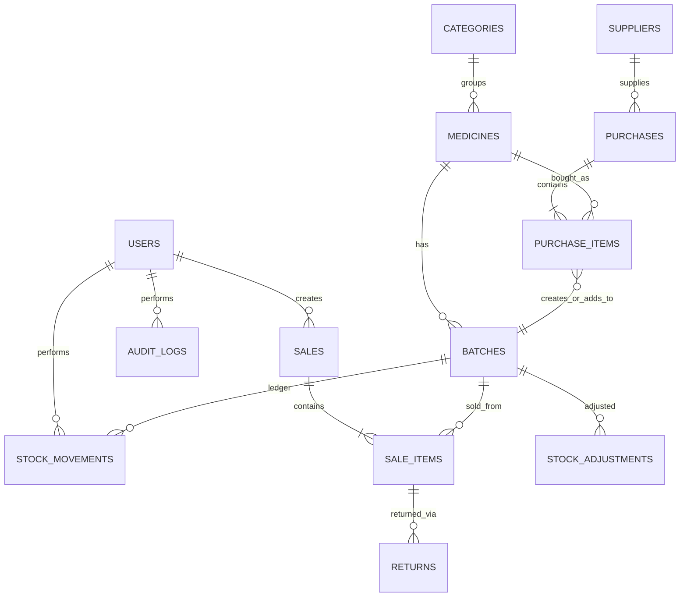

# PRD: Pharmacy Management System

**Context:** Algions AI Labs Pvt Ltd, Full-Stack Web Development internship assessment. Individual project; window 8–14 Nov 2026 (7 days, deadline Sat 14 Nov end of day).
**Evaluation (100):** business-rule correctness 30 · architecture/data model/APIs 20 · security/authz/integrity 15 · testing/reliability 15 · UI/UX/responsive 10 · documentation/demo 10.
**Principle:** a strong, correct MVP beats many incomplete screens. Unfinished items must be stated honestly (README "Known limitations").

---

## 1. Goal and non-goals

**Goal:** a responsive, database-backed web app for pharmacy operations where a reviewer can complete the principal journey (buy stock → sell with FEFO → return/adjust → see results in reports) and verify every result in the staff/admin views.

**Non-goals (do not build):** payments/gateways, online ordering or customer accounts, prescriptions/doctor data, medical advice or drug-interaction info, multi-branch/multi-tenant, email/SMS, barcode hardware, microservices, any other domain.
All data is **fictional** (fictional medicine names, dummy users).

## 2. Users and roles

| Role | Who | Can do |
|---|---|---|
| `ADMIN` | Owner/manager | Everything, including users list, settings, audit logs, all reports |
| `PHARMACIST` | Counter staff | Create sales, view invoices, process returns, view inventory/alerts |
| `INVENTORY_MANAGER` | Stock keeper | Catalogue, suppliers, purchases, adjustments, inventory, alerts, expiry/stock reports |

Permission matrix (server-enforced; UI hiding is cosmetic only):

| Capability | ADMIN | PHARMACIST | INVENTORY_MANAGER |
|---|:-:|:-:|:-:|
| Login / view own profile | ✅ | ✅ | ✅ |
| View catalogue (medicines, categories, suppliers) | ✅ | ✅ | ✅ |
| Create/edit/deactivate catalogue | ✅ | ❌ | ✅ |
| Create purchases | ✅ | ❌ | ✅ |
| View batches / inventory / movements | ✅ | ✅ | ✅ |
| Create sale, view sales and invoice | ✅ | ✅ | ❌ (view sales: ✅) |
| Process return | ✅ | ✅ | ❌ |
| Create stock adjustment | ✅ | ❌ | ✅ |
| View alerts | ✅ | ✅ | ✅ |
| Sales report | ✅ | ✅ | ❌ |
| Stock valuation, expiry, reconciliation reports | ✅ | ❌ | ✅ |
| Dashboard | ✅ | ✅ (sales view) | ✅ (stock view) |
| Audit logs, settings, users | ✅ | ❌ | ❌ |

## 3. Principal user journeys

1. **Receive stock (Inventory Manager):** pick supplier → add lines (medicine, batch no., qty, cost price, sale price, expiry) → save → batches appear/increase, `PURCHASE` movements written.
2. **Sell (Pharmacist):** search medicine → add lines with qty → server validates and allocates by FEFO (may span batches) → sale completed, tax computed, invoice shown/printable → batch quantities drop, `SALE` movements written.
3. **Return (Pharmacist):** open a sale → choose item and qty → give reason → stock restored to the original batch, `RETURN` movement written, audit logged.
4. **Adjust (Inventory Manager):** pick batch → delta (±) → reason (e.g. damaged, count correction) → blocked if result < 0 → `ADJUSTMENT` movement + audit.
5. **Monitor (any staff):** dashboard + alerts show low-stock and near-expiry/expired batches.
6. **Report (Admin/Manager):** sales, stock valuation, expiry, and reconciliation reports.

## 4. Functional requirements

### FR-1 Auth and users
- Login with email + password → JWT. `GET /auth/me`.
- Passwords hashed (bcrypt). Rate-limit login. Three seeded demo users (dummy credentials), one per role.

### FR-2 Catalogue
- **Categories:** name (unique).
- **Suppliers:** name, contact person, phone, email, address (fictional), active flag.
- **Medicines:** name, generic name (optional), SKU (unique), category, unit (e.g. strip/bottle), reorder level, tax rate %, default sale price (optional), active flag. Deactivate instead of delete when referenced.
- List endpoints support search, filter, pagination.

### FR-3 Purchases and batches
- A purchase has a supplier, supplier invoice no., date, and ≥1 item: medicine, **batch no., quantity (>0), cost price, sale price, expiry date**.
- Receiving a purchase creates the batch (or adds to an existing batch with the same `(medicine, batch_no)` provided expiry matches; otherwise reject with `CONFLICT`) and writes a `PURCHASE` movement per item, all in one transaction.
- Expiry date for a new purchase must be in the future.

### FR-4 Sales and invoicing
- Sale has ≥1 line (medicine + quantity), optional customer name/phone (fictional), payment method label (CASH/CARD/UPI; label only, no payment processing).
- Server validates qty > 0 (integer), medicine active, **sufficient non-expired stock**.
- **FEFO allocation:** for each line take from non-expired batches with stock, ordered by earliest expiry (tie-break: oldest purchase / lowest id), spilling to the next batch as needed. One `sale_items` row per batch allocation.
- Prices come from the chosen batch's sale price; tax from the medicine's tax rate (or the global default). Totals computed on the server.
- Invoice number generated server-side (`INV-YYYY-000001`, sequential, unique).
- `POST /sales` requires an `Idempotency-Key`; a repeated key returns the original sale (not a second sale).
- Printable invoice data endpoint + a print-friendly invoice page.

### FR-5 Expiry and stock rules
- Expired batches can **never** be sold (enforced server-side even if a batch is somehow targeted).
- Low stock: a medicine's total non-expired quantity ≤ its reorder level.
- Near expiry: batch with stock expiring within N days (setting, default 60) and not yet expired.
- Expired-with-stock batches are surfaced in the expiry report/alerts.

### FR-6 Returns
- Return references a sale item, quantity (> 0, ≤ sold − already returned) and a **mandatory reason**.
- Stock is restored to the **original batch** (`RETURN` movement). Expired batches remain unsellable regardless.
- Sale status derives from returns: `COMPLETED` → `PARTIALLY_RETURNED` → `FULLY_RETURNED`.

### FR-7 Stock adjustments
- Adjustment targets a batch, a non-zero integer delta, and a **mandatory reason** (enum + optional note).
- Rejected if `quantity_on_hand + delta < 0` (`INSUFFICIENT_STOCK`).

### FR-8 Audit trail and ledger
- `stock_movements`: append-only ledger of every quantity change (types `OPENING`, `PURCHASE`, `SALE`, `RETURN`, `ADJUSTMENT`) with reference id, reason, user, timestamp.
- `audit_logs`: material actions (login failures optional, purchase created, sale created, return processed, adjustment made, catalogue changes, settings changed) with before/after JSON.

### FR-9 Alerts, dashboard, reports
- **Alerts:** low-stock list, near-expiry list, expired-with-stock list.
- **Dashboard:** today's sales total and count, low-stock count, near-expiry count, expired-with-stock count, recent sales/movements.
- **Sales report:** date range, totals (subtotal, tax, total), per-day or per-medicine breakdown.
- **Stock valuation:** per batch/medicine `qty × purchase price` (and potential sale value), totals.
- **Expiry report:** expired, expiring in ≤ N days, grouped by medicine/batch.
- **Reconciliation report (date range):** per medicine (and batch): opening + purchases − sales + returns ± adjustments = closing; flags mismatch vs. current batch quantity when range ends now.

### FR-10 Settings (admin)
- Default tax rate %, near-expiry window in days. Stored in a `settings` table.

## 5. Business rules (testable)

| ID | Rule |
|---|---|
| BR-1 | Stock is tracked per batch; medicine total = sum of its batches. |
| BR-2 | Sales allocate by FEFO across non-expired batches. |
| BR-3 | A batch is expired when `expiry_date <= today`. Expired batches cannot be sold. |
| BR-4 | Stock can never become negative (service check **and** DB `CHECK`). |
| BR-5 | Every quantity change writes exactly one ledger row in the same transaction; invariant `SUM(delta) = quantity_on_hand` per batch. |
| BR-6 | Sale creation is atomic: either all lines are deducted or none. |
| BR-7 | Same `Idempotency-Key` + same payload → original sale returned; same key + different payload → `IDEMPOTENCY_CONFLICT`. |
| BR-8 | Concurrent sales cannot oversell the last units (row locks). |
| BR-9 | Returns can't exceed sold − returned and need a reason. |
| BR-10 | Adjustments need a reason and can't push stock below zero. |
| BR-11 | Prices/tax/totals are server-computed; client values are ignored. |
| BR-12 | Money is stored/calculated as fixed-point decimals with one rounding rule (half-up to 2 dp, applied per line). |
| BR-13 | Inactive medicines can't be sold or purchased. |
| BR-14 | Role permissions in §2 are enforced server-side. |

## 6. Data model

Key tables (fields abbreviated; PK `id` everywhere, `createdAt/updatedAt` where useful):

- **users**: name, email (unique), passwordHash, role (enum), isActive
- **categories**: name (unique)
- **suppliers**: name, contactPerson, phone, email, address, isActive
- **medicines**: name, genericName?, sku (unique), categoryId, unit, reorderLevel, taxRate?, defaultSalePrice?, isActive. Index on name.
- **batches**: medicineId, batchNo, expiryDate (DATE), quantityOnHand (int, `CHECK >= 0`), purchasePrice, salePrice, supplierId?. **Unique (medicineId, batchNo)**. Index on expiryDate, (medicineId, expiryDate).
- **purchases**: supplierId, supplierInvoiceNo, purchaseDate, totalCost, createdById
- **purchase_items**: purchaseId, medicineId, batchId, quantity, costPrice, salePrice, expiryDate
- **sales**: invoiceNo (unique), customerName?, customerPhone?, paymentMethod, subtotal, taxTotal, total, status (enum), idempotencyKey (unique), requestHash, createdById, createdAt. Index on createdAt.
- **sale_items** (one row per batch allocation): saleId, medicineId, batchId, quantity, unitPrice, taxRate, taxAmount, lineTotal, returnedQuantity (derived/updated in the same txn as returns)
- **returns**: saleItemId, quantity, reason, createdById, createdAt
- **stock_adjustments**: batchId, delta (non-zero int), reasonCode (enum), note?, createdById
- **stock_movements** (append-only): batchId, type (`OPENING|PURCHASE|SALE|RETURN|ADJUSTMENT`), qtyDelta, referenceType, referenceId, reason?, createdById?, createdAt. Index (batchId, createdAt), (type, createdAt).
- **audit_logs**: userId?, action, entityType, entityId, before (json), after (json), createdAt
- **settings**: key (unique), value (e.g. `defaultTaxRate`, `nearExpiryDays`)

DB-level protections: `CHECK (quantity_on_hand >= 0)`, `CHECK (quantity > 0)` on items/returns, FK constraints, unique constraints above. The `CHECK` is added by editing the generated migration SQL (Prisma can't express it).

## 7. API surface (`/api/v1`)

| Area | Endpoints |
|---|---|
| Health/docs | `GET /health` · Swagger UI at `/docs` |
| Auth | `POST /auth/login` · `GET /auth/me` |
| Catalogue | `GET/POST /categories`, `PATCH /categories/:id` · `GET/POST /suppliers`, `GET/PATCH /suppliers/:id` · `GET/POST /medicines`, `GET/PATCH /medicines/:id` |
| Purchases | `POST /purchases` · `GET /purchases` · `GET /purchases/:id` |
| Inventory | `GET /batches` (filters: medicineId, status=active/expired/near-expiry, search) · `GET /batches/:id` · `GET /stock-movements` (filters: batchId, type, date range) |
| Sales | `POST /sales` (`Idempotency-Key` header) · `GET /sales` · `GET /sales/:id` · `GET /sales/:id/invoice` |
| Returns | `POST /sales/:id/returns` · `GET /returns` |
| Adjustments | `POST /adjustments` · `GET /adjustments` |
| Alerts | `GET /alerts/low-stock` · `GET /alerts/near-expiry` · `GET /alerts/expired` |
| Reports | `GET /reports/sales` · `GET /reports/stock-valuation` · `GET /reports/expiry` · `GET /reports/reconciliation` |
| Dashboard | `GET /dashboard/summary` |
| Admin | `GET /audit-logs` · `GET/PUT /settings` · `GET /users` |

All list endpoints: pagination + relevant search/filters. All responses use the shapes in `AGENTS.md §6`.

## 8. Non-functional requirements

- **Security:** bcrypt, JWT with expiry, server-side RBAC on every route, Zod validation on every input, Helmet, CORS limited to the frontend origin, login rate limit, no secrets in git, no stack traces to clients, generic login error messages.
- **Integrity:** transactions, row locks, unique + CHECK constraints, idempotency, append-only ledger.
- **Reliability:** consistent error codes; graceful handling of DB errors; `/health` endpoint.
- **UX/accessibility:** responsive down to phone width; labelled inputs, keyboard navigation, focus states, sufficient contrast; loading/empty/success/error states on every data view; confirmation on destructive/irreversible actions.
- **Performance:** indexes on filtered columns; paginated lists; no N+1 in report queries.
- **Reproducibility:** repeatable migrations + seed; `.env.example`; documented one-sequence local setup (optionally Docker Compose).

## 9. Acceptance criteria (must be demonstrable and covered by automated tests)

| # | Criterion | Test evidence |
|---|---|---|
| A1 | A sale deducts quantity from the correct (FEFO) batch and records a `SALE` stock movement | integration test: two batches, sale spans both; assert quantities + movements |
| A2 | An expired batch cannot be sold | integration test: only-expired stock → `INSUFFICIENT_STOCK`/`BATCH_EXPIRED` |
| A3 | System warns about low-stock and near-expiry batches | integration test on `/alerts/*` + dashboard counts |
| A4 | Returns/adjustments require a reason and are auditable | validation test (400 without reason) + audit log + movement assertions |
| A5 | Stock report reconciles with opening, purchases, sales, adjustments | integration test on `/reports/reconciliation`; ledger invariant test |

Additional required tests: negative (oversell), conflict (duplicate Idempotency-Key and/or concurrent sales on last units), RBAC (403), validation (400), unit tests for FEFO selection, tax/rounding and return limits.

## 10. UI screens (frontend)

Login · Dashboard · Medicines (list/create/edit) · Categories · Suppliers · Purchases (list/create/detail) · Inventory/Batches (filters: expired, near-expiry, low-stock) · New Sale (POS-style) · Sales list · Invoice (printable) · Returns (from sale detail) · Adjustments · Alerts · Reports (sales, valuation, expiry, reconciliation) · Audit log (admin) · Settings (admin).
Navigation and visible actions adapt to role, but the server remains the authority.

## 11. Testing strategy

- **Unit:** FEFO selection, tax/rounding, return limit calc, date/expiry helpers.
- **Integration/API (Supertest + test DB):** the five acceptance tests, negative/conflict/RBAC/validation cases, ledger invariant.
- **Manual/E2E:** full journey on the deployed (or local) app before submission; responsive check at ~375px.
- Evidence: test output captured in `docs/test-evidence.md` (or CI log screenshot) and referenced from the README.

## 12. Deliverables checklist (submission package)

- [ ] Repo with frontend, backend, migrations, seed
- [ ] README: architecture, setup, env vars, demo credentials, DB setup, test commands, known limitations
- [ ] ER/schema diagram (`docs/er-diagram.png` + Mermaid source) and API docs (OpenAPI/Swagger)
- [ ] Automated tests + evidence that critical cases pass
- [ ] Demo URL (or declared local-only with exact run steps), dummy credentials only
- [ ] 3–5 min walkthrough video + short technical report (`docs/technical-report.md`)
- [ ] Submission form: identity, assignment confirmation, repo URL + branch + final commit ID (reviewer access if private), demo + video links, docs links, tech stack + limitations, **AI usage and attribution**, declarations (originality, can explain code, no real sensitive data/secrets, all links work)
- [ ] Final regression + link/permission check before the deadline

## 13. Assumptions and open decisions

Defaults chosen (change only with a recorded decision in `PROGRESS.md`):
- Quantities are whole units (integers). Tax is per-medicine rate with a global default fallback. Tax-exclusive pricing (tax added on top of the line subtotal).
- Sales are created directly as `COMPLETED` (no draft state). Purchases are received immediately (no PO workflow).
- Returns restock to the original batch; no refund/payment processing.
- Auth: Bearer JWT in the `Authorization` header (default; revisit if httpOnly cookies via a Next.js rewrite proxy are chosen later).
- Customer data is optional and fictional; no customer accounts.

## 14. Risks

| Risk | Mitigation |
|---|---|
| Free-tier cold starts (Render ~1 min, Neon wake-up) | README note; warm the demo before review/video; loading states |
| Time overrun on UI | UI is only 10 marks; follow cut order; reuse shadcn components |
| Concurrency bugs | Row locks + dedicated concurrency test |
| Can't explain AI-assisted code | Mentor workflow; human writes core logic; Interview notes in `PROGRESS.md` |
| Broken links at submission | Sat 14 Nov link/permission checklist; submit by ~6 PM, not at the last minute |
| Only 7 days instead of 15 | Scope trims in `PROGRESS.md`; feature freeze Fri night; backend correctness first |