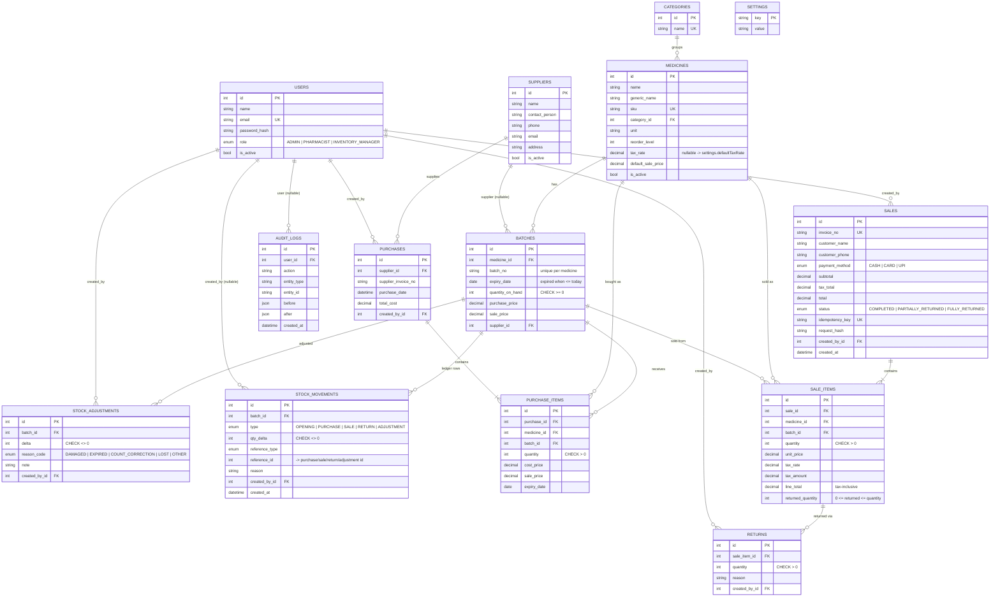

# ER diagram

Source of truth: `backend/prisma/schema.prisma`. Render this Mermaid block to
`docs/er-diagram.png` when the schema changes. The relationship labels name the
business meaning of each foreign key.

## Notes

- **Ledger invariant:** for every batch, `SUM(stock_movements.qty_delta) = batches.quantity_on_hand`.
- `stock_movements.reference_id` intentionally has no FK: it points at one of four tables depending on `reference_type`.
- `batches` is unique on `(medicine_id, batch_no)`; money columns are `DECIMAL(12,2)`; dates are `DATE`.
- DB-level `CHECK` constraints live in `backend/prisma/migrations/*/migration.sql` (hand-edited).
